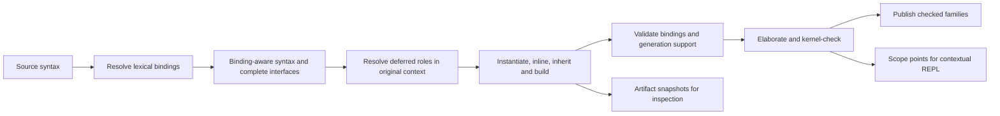

# Correct capture and bindings

Status: CB0 baseline and witnesses implemented, 2026-10-13; CB1–CB7 pending.
The [baseline report](../reports/capture-bindings-baseline.md) records exact
known defects, active controls and contextual-execution TODOs.
The production baseline is `docs/frontend-generation-roadmap` at
`f0417ee0`; the motivating review is #219 at `d3d8f21e`. The
[open-PR comparison](../reports/capture-bindings-pr-comparison.md) records
what to adopt, replace and leave independent in the other current PRs.

Replace spelling-based capture repair with a frontend representation that
preserves binding identities through retention, substitution, inheritance,
generation and elaboration. Give lexical contexts an explicit representation
that also supports opening a REPL inside functions, nested induction cases
and proof blocks, with their actual local bindings and goals.

This replaces FG2's implementation approach and the binding-related part of
RC4 in #224, while retaining their semantic goals. It strengthens the
[syntax hygiene contract](syntax-hygiene.md); it does not require the later
PRs to merge unchanged before a better implementation can replace them.

## Outcomes and boundaries

Local variable spelling must not force users to rename helpers, patterns or
generated models to avoid compiler capture. Remove capture-only E801, E860,
E869 and E871 paths after their consumers migrate. Replace E866's expansion
hazard with explicit references to the previous dependency and the new
artifact. Preserve real duplicate declarations and ambiguous interfaces.
Preserve ordinary lexical shadowing as well: if a source parameter
`Monoid : Nat` hides the theory, `Monoid.one` must not silently reach the
global theory. That invalid source use (currently E862) is different from
a compiler transformation capturing an already resolved reference.

Binding correctness does not make every construction supported. Recursive
unfolding in field types, nonstructural self-recursion, unsupported transport,
universe lowering and unavailable dependencies remain distinct refusals.
In particular, preserving a recursive helper's identity does not make it an
admissible field-type dependency.

The parser/formatter can keep source names; core and kernel binders need no
representation change. The new boundary applies before frontend syntax is
retained or moved. Historical syntax stays behind a compatibility adapter,
not a second production binding semantics. This proposal adds no kernel
rule, axiom, deriving capability or universal-property proof.

## What must change

| Reviewed mechanism | Demonstrated weakness | Replacement |
| --- | --- | --- |
| Globals use `reference`, open/local uses often remain `name` | A recursive call exposed by inlining can become a same-named global | Identity-bearing local/interface references; no destination spelling fallback |
| #219: dependency lookup combines interface and all eventual fields | A later helper replaces an earlier header parameter | Resolve in the ordered declaration scope; analyze occurrence IDs |
| Inlining combines reduction and selective refusal | Replacement children escape validation | Separate expansion from complete result/dependency validation |
| Pattern/statement binders are non-renamable | Capture prevention becomes a user-facing rename request | Explicit binder IDs and deferred pattern/goal-dependent roles |
| #219: inherited binder offsets lack source ownership | An imported binder's range is interpreted in the caller | Source-qualified origins and separate expansion sites |
| REPL entries import the final module | Function locals, induction hypotheses and intermediate scopes are unavailable | A contextual session rooted in an elaboration scope point |

Retain the shared scope schema, structured members, global references,
publication groups and independent semantic clients. Extend their contracts
instead of adding another general visitor and another capture service.

## Shared representation

These are data contracts; implementation need not introduce a class or AST
kind for every row. Register any new kinds and opaque payload boundaries in
the common traversal schema.

| Record | Required information |
| --- | --- |
| Binding | Opaque ID, role, owner, public label and definition origin. Roles distinguish declarations, locals, universe/dimension binders, parameters, fields and helpers. |
| Reference occurrence | Binding ID, written spelling and occurrence origin. Role is obtained from the binding table, never inferred from spelling. |
| Declaration interface | Ordered parameter groups with explicit shared domains, result/body, open interface IDs, notation context and owned identities. |
| Lexical context | Immutable source-scope resolution, deferred model-opening frames and notation selections; explicit links to open binders; known missing lookups remain missing outside those explicit deferred effects. |
| Selection activation | Authored recipe origin, activation occurrence and lexical context; resolved receiver or deferred receiver slots, interface and enclosing resolution; pending/ready/failed outcome with source-qualified failure. Explicit consumer policy requests notation selection, label opening, both or neither. Separate source activation from copying an already activated selection. |
| Deferred interpretation | Original syntax/operation, lexical-context ID, candidate binding slots and the type/goal information required to finish resolving it. |
| Origin | Source/module revision ID and offsets; expansion frames identify call, inheritance and generation sites without overwriting authored positions. |
| Artifact | Declaration/owner/group IDs, family/role, complete syntax, origins, dependencies and publication state. |
| Elaboration attempt | Parent/owner path, pending/selected/discarded outcome and owned observational effects: references, proof steps and scope points. Selection composes through all enclosing attempts; work accounting is independent. |
| Scope point | Revision, occurrence, before/after phase and expansion/attempt path; lexical context, ordered checked local context, local values, refinements, dimensions/faces, evidence, recursion state and optional goal. |

IDs must distinguish same-spelled binders and survive serialization/replay
with an explicit correspondence. Do not derive them solely from labels,
offsets or JavaScript object identity. Allocate deterministically under a
compilation/module revision and declaration/expansion owner. Invalidating
changed revisions is sufficient; stable IDs across arbitrary edits are not
required. Compare independent runs up to binding correspondence.

The invariants are:

1. A resolved reference never asks the destination source environment what
   its spelling means. An unresolved source occurrence cannot become an
   unrelated destination declaration.
2. Every local reference has a dominating binder or belongs to an explicit
   open interface. A group's domain precedes all of that group's binders;
   subsequent groups and the result/body see them.
3. Cloning a declaration for a new instance freshens its bound IDs and all
   corresponding uses. External references remain shared. Merely revisiting
   immutable syntax does not allocate new identities.
4. Type-dependent decisions retain their source context. They cannot silently
   count as fixed, dependency-free or supported before resolution.
5. Public labels, origins and availability are separate from identity.
   Named argument labels remain stable when internal IDs are freshened.
6. Knowing an artifact ID does not grant access to an unchecked reservation.
   Existing publication groups still control availability.

For example, a helper's reference to field `c` carries the field's ID. A
law parameter also spelled `c` has a different ID. Inserting the helper's
body under that parameter changes neither reference. Pretty-printing may
select clearer labels. Binding preservation during transformation does not
depend on finding an unused spelling; the generated view separately requires
binding-faithful printing, as specified below.

## Resolution and scoping

This is a phase contract, not an eager whole-program pass. Lexical resolution
fixes scope where text enters the compiler, in declaration order. Reserving
later identities does not make later declarations visible. A recursive
definition gets its permitted self-reference; unrelated forward references
remain unavailable. Preserve file-level `use` precedence, explicit selections
and B1's existing semantics.

Resolution interleaves with elaboration when types or proof goals decide
roles. Signatures may be checked in their ordered abstract telescope, in a
temporary context, without publishing assumptions or adding kernel axioms.
Reuse checked results when their context is unchanged; do not repeat whole
elaboration for each generator. Preserve existing limits and each speculative
site's accounting policy, separately from whether its observations are kept.

Distinguish two environments: lexical scope maps source occurrences to IDs;
elaboration maps IDs to current terms, types, dimensions and refinements.
Retained lexical contexts must not freeze mutable checker objects or native
handles that may be rolled back. An explicit open interface reconnects them
to the destination's checked context. A branch refinement changes the value
of a local without changing which lexical binding it is.

### Patterns, statement scopes and notation

`translator/patterns.mjs` resolves a bare pattern name as a nullary
constructor or a variable using its expected type. Giving every such token
an ordinary binder ID at parse time would change the language.

The current `mayBeConstructor` also scans the checker's inductives by
spelling, and `constructorWithout` consults the current environment when
the matched type is unknown. CB3 must replace these ambient probes for
retained syntax. Record source-visible constructor identities and any
candidate inventory needed by the pattern compiler in the deferred record;
an unrelated inductive added at the destination cannot affect it. A probe
used only to select a compilation path must not become semantic resolution.

Use a deferred slot for each ambiguous position. An affected body occurrence
retains the candidate local slot and its enclosing lexical resolution,
including a missing lookup. When the type decides the role, a variable
introduces a binder ID; a constructor introduces no variable and the body
uses its saved enclosing resolution. Constructor selection itself follows
the matched type's constructor table. Preserve nested patterns, coordinates,
induction hypotheses and existing shadowing behavior.

Deferred slots remain explicit into elaboration. Once the role is known,
the shared adapter installs the selected binder/constructor mapping and
lowers the affected references before their consumer runs. An entry-time
walk cannot lower a still-undecided slot to an ordinary source name. CB1's
pattern pilot must exercise this resolution-time lowering; CB3 removes the
corresponding spelling probes.

Substitution under unresolved slots changes resolved references or records
an explicit substitution environment. An inserted argument keeps its own
references and is not retrospectively captured by a candidate binder.
Do not rewrite opaque clause text and then re-resolve it in the caller.

Statement targets get IDs as their binding effects become known. An
initializer sees preceding statements; later statements see its new IDs.
When a proof goal determines the effect of `intro`, `obtain`, `ext` or a
related statement, retain the remaining block with explicit slots and its
original lexical context until that effect is determined.

Opening a model is another deferred lexical effect. Block/file `use`, section
parameters and `m.(expression)` can introduce bare field and derived labels
only after the receiver's type is known (`opened` in `translator/theories.mjs`).
An activation retains the receiver occurrence and its activation
context, separately from the authored recipe's origin. Block/section openings
and explicit selections activate at their lexical source point. File-level
`use` is an ordered source recipe: each subsequent source item activates it
according to that item's consumer policy in its current ordered module scope,
before declaration parameters where applicable. Each activation has its own occurrence/ID and
resolves its receiver once there; the authored origin still points to the
written `use`. This preserves the existing re-resolution of file-level
receivers, including E343 when a later declaration shadows a receiver root.
It does not rebind an existing reference ID. Retained or compiler-generated
copies inherit the resolved activation, never activate a source recipe again
in the transformation's destination.

Subsequent bare occurrences keep candidate opened-label slots and their saved
enclosing resolution, including a missing lookup. Once checked, the receiver's
record maps those slots to its projection IDs applied to that receiver;
unprovided labels retain the saved resolution. Ambiguous labels fail at use.
File-level openings outrank module globals, including globals declared after
the written `use`; declaration parameters and later local binders can shadow
opened labels. Block openings shadow preceding local bindings, and later
local binders shadow them. Opened labels hide conflicting `label.*`
declarations under the existing rules.
Resolve chained openings in order, including a model obtained by a call or
from an earlier opened field. A same-spelled global must not be resolved
eagerly past a pending opening. Scope points retain these effects too.

Selections have two separate effects: notation selection (operators, literal
rules and operand recipes), and label opening (bare model fields/derived
names). Written `use` and `m.(...)` request both effects under the existing
shadowing rules. Compiler-synthesized operand selections request only the
notation effect; they cannot bind names over the operand's caller locals or
globals. Carry the requested effects explicitly in the activation record.

Register consumer policies in the shared scope schema, rather than assuming
every item carrying `uses` consumes them. Preserve the current policies:

| Consumer | File-level selection effects |
| --- | --- |
| Definitions, inductives, theories, initial/free generation requests and their retained source contexts | Notation selection and label opening, before local parameters |
| `evaluate`, `print`, `notation` and subsequent `use` directives | Notation selection and label opening, in item order |
| `simp_rule`, `simp_set` and `hlevel_rule` registrations | Neither; rule names resolve in the ordered module environment |

These policies govern activation, not just filtering an already opened
environment: a registration must not resolve/check an unused opening's
receiver. Unknown new item kinds need an explicit schema policy. Nested
written selections and synthesized operand recipes retain their explicit
effect requests independently of this file-level policy. A retained copy
preserves its consumer's resolved context rather than adopting the policy
or scope of a destination item.

Activation is a checked prerequisite, not a best-effort context enrichment.
A required activation that fails refuses its consuming item with the original
receiver diagnostic (for example E343) and source-qualified origin. Pending
activation cannot be treated as a ready, unopened environment. For theories,
remove `capturedScope`'s catch-and-return-null fallback: check the activation
before retaining the interface, and propagate a failed outcome to every
generated group depending on it. None of that theory's family may publish
by capturing in the unopened module environment. This replaces the current
accidental reliance on generated declarations re-reading `uses` to rediscover
the failure. It does not roll back independent earlier items or change FG1's
publication boundaries for groups whose required contexts succeeded.

Notation records retain selected rule identities, original rule scope and
the separate contexts of operands. Selection may need a checked model;
retain that deferred receiver explicitly. An explicit operand-selection recipe
such as `x ^ additive_.(n)` captures the model/notation receiver in the rule's
declaration context, using the same activation representation and open
interface. Do not retain `leftView`/`rightView` as bare names and construct
client-resolved `select` nodes later. Apply inheritance/interface substitutions
to the captured receiver IDs. Each operand keeps its caller's name resolution
with only the captured notation effect applied to it; an absent explicit
operand recipe preserves the existing ambient notation behavior. Thus a
caller's parameter `one` remains that parameter in `P.(x ^ one)` even when
the rule's operand model also has a field `one`. An otherwise unbound operand
name cannot acquire a binding from the synthesized recipe. This intentionally
corrects the current implementation's accidental label opening, consistent
with notation's operand-hygiene contract. A structural member keeps its
resolved receiver and public field label until the receiver's type selects
the projection ID. Neither is treated as a dotted global string.

Allow late label lookup only in explicit namespaces: reserved builtins and
universe syntax under their existing shadowing rules; constructor labels in
the matched type's table or the saved source candidate inventory; named
arguments, member labels and deferred opened labels in the resolved interface;
and notation rules
selected through their saved scope/receiver. Each lookup produces an ID or
an explicit failure. None may search the destination's ambient declarations
to recover a retained reference or a missing source lookup.

Dependency analysis conservatively exposes dependencies/pending obligations
of deferred interpretations. A final support decision must resolve any
interpretation that can change admissibility in its original checked
context. Do not classify it as fixed or refuse every deferred pattern
indiscriminately: the early pilot must demonstrate both constructor and
variable interpretations.

## Capture, substitution and inheritance

Retain complete parameter groups directly instead of reconstructing them
from equal-looking domain syntax. Generated evidence parameters are explicit
dependent groups. Derived operations share the declaration interface, adding
a body and call classification to their signature.

`instantiate(expression, interfaceId -> expression)` substitutes by ID.
It preserves the free identities of replacements; cloning freshens bound
IDs and their uses consistently. Changing a label does not change identity.
Named calls assign public labels to parameter IDs before substitution.
There is no comparison between free spellings and forbidden local names.

Inheritance uses an explicit parent-to-child field map. Child fields have
their own IDs and retain origin IDs. Diamond sharing and independent-parent
conflicts still obey the language rules. A field rename changes its public
label and correspondence, not arbitrary strings inside expressions.

Replace the `sameSyntax` comparisons in `theories.mjs`'s carrier preparation
and field insertion with structural equivalence up to binding correspondence.
First apply each parent's actual arguments and parent-to-child interface
map; compare bound IDs up to alpha-renaming and external IDs exactly. This
does not introduce general definitional equality. A shared origin identifies
a diamond candidate, but its instantiated kind and type must still agree:
the same ancestor at different arguments need not share. Independent-parent
carriers/evidence may share only under the existing kind/type rules. Allocate
one child ID for a shared field and map every accepted parent occurrence to
it. Fresh clone IDs must neither prevent valid sharing nor hide conflicts.

Expansion of nonrecursive helpers is separate from validation of the full
expanded signature and its helper dependencies, with cycle detection.
Replacement subtrees cannot bypass validation because a generic visitor
stops at replacement nodes.

Classify references/calls as nonrecursive helpers, earlier checked recursive
values, or the current definition's structural self-calls. Preserve the
private recursion mechanism for the last case. Field types/laws keep E845
for unsupported recursive dependencies, including bare references and calls
hidden inside helpers. Ordinary derived values still call checked earlier
recursive operations. Point refusal at the written request, with the
helper definition as a related origin when useful.

## Frontend generation and checking

Dependency graphs consume occurrence IDs. Do not adopt #219's
`DependencyAnalysis.byName` as a semantic resolver; label indexes are for
display only. Keep Hom/Iso and equational support as distinct predicates
and preserve their mapping plans.

A narrow builder constructs generated declarations using the same telescope
and reference representation. It allocates artifact and local IDs and
composes expressions directly. Remove the semantic round trip through
record conversions, source strings, reparsing and spliced name markers.
Formatting generated text for display remains valid; that text is never
read back to reconstruct its semantic bindings.

Adopt #220's universe inference from complete generated types, including
fixed domains and preservation fields. Binding analysis is not a replacement
universe calculator. Adopt #221's checked evidence and refinement/face/
generalization handling, carrying witness, type, model and dimensions
together. Evidence and generated references must respect failure/rollback.

A temporary adapter lowers resolved IDs to private environment keys at
elaboration entry and when deferred slots resolve inside elaboration. Its
entry traversal preserves deferred records, their contexts and pending
substitutions. It installs exact mappings before each resolved consumer,
rejects missing IDs and has no spelling fallback. Keep one adapter shared by
both entry points; retained records never receive private keys as source names.

Preserve FG1's independent base, derived, Hom, Iso and initial/free publication
groups. Replacing capture does not justify a new all-or-nothing theory
transaction or exposing failed declarations through an inspection snapshot.

## Contextual REPL at arbitrary nesting depth

Opening a REPL inside a function or induction case is a required outcome,
not a possible future benefit. The depth limit is the language's ordinary
resource limits, not a fixed set of supported syntax depths.

The current `ReplSession` chains small modules importing the previous one.
Keep that module-level behavior. Add a contextual backend that elaborates
entries under a `ScopePoint` through the same resolver, elaborator and
checker as source code; importing the final module cannot supply this
context. Share command parsing and rendering, not a second checker.

### What the user can do

- Open a console from an expression, function body, proof statement or
  induction/match case, and see the enclosing scope path.
- List visible locals/lets with types and inspect their definition origins;
  show shadowed outer bindings separately without changing source lookup.
- Use `typeof`, `evaluate`, ordinary expression input and term inspection
  with the local notation, imported declarations, parameters and lets.
- Add checked scratch `let` bindings that persist only in that session.
  In a proof scope, inspect the active goal and try a proof fragment against
  a scratch copy of it. Successful experiments do not edit the source.
- Inside an induction case, access its predecessor/constructor arguments,
  induction hypotheses, refined dependent types and local evidence.

For example, after a branch-local `let next_ := succ(k)`, `typeof next_`
reports `Nat` and `evaluate next_` can report `succ(k)`. No concrete value of
`k` is invented. `/locals` and `/goal` are proposed console commands, not
new Cubist keywords. A function body has an expected result type where
known; it need not have a tactic goal. Evaluation of open terms may remain
symbolic. Closed-witness readout retains its existing closedness restriction.

The REPL observes an elaboration context, not a runtime stack frame from a
particular call. Supplying concrete arguments could later specialize a
session, but is not required to understand/check expressions under locals.

### Exact scope and lifetime

Index semantic entry points rather than every character: expression entry,
parameter-group domain/body, statement before/after, clause entry and proof
goal transitions. Keep parent links and source-qualified ranges so a click
finds the innermost relevant source occurrence. Never select a nearby sibling or a
later scope merely because its source range is close. Let initializers
cannot see their own binding; later statements can. An arbitrary nesting
depth does not imply a valid context exists after a parse or scope error.

An occurrence maps to a set of selected elaboration instances. An overlapping
multi-value match can elaborate one clause body under several constructor
refinements; a law can appear in several generated artifacts. Retain each
instance's branch/expansion path, refined context and goal. The UI lists them
with those labels and requires an explicit instance selection before querying;
it never silently takes the first or last. Proof-experiment success is scoped
to that instance, and is no claim that the fragment works for the whole clause.
Only checking every instance could establish that stronger claim.

Give elaboration attempts ownership of all observational effects, including
reference records, proof steps and scope points. Buffer effects until the
attempt is selected; discarding an attempt discards its nested observations
even if a nested attempt succeeded. Every elaborate-then-fallback site must
participate: quiet argument inference, recursive/generalization retries and
the written implicit-path wildcard body versus `automaticClause` fallback.
Audit other speculative/recovery sites under this same contract; existing
inspector buffering is not a complete inventory. Observation ownership does
not decide accounting: recursive/generalization attempts preserve their
current isolated fuel, work and search records and charge only the selected
attempt to the declaration. Quiet argument inference and implicit-path
fallback retain their direct declaration charges, even when their observations
are discarded. Kernel work counters and the declaration deadline remain
cumulative across attempts. Replaying a prefix reproduces these policies
without resetting a deadline between attempts or changing fuel limits.
A selected attempt may contribute a
successfully elaborated prefix even when its enclosing declaration later
fails; this does not publish that declaration. Abandoned attempts contribute
no clickable contexts. Replaying a selected path must reproduce its recorded
context before the query callback runs; otherwise report it unavailable.

Scope points retain binding IDs, ordered types, let values, branch/face
refinements, interval dimensions, evidence, selected notation, recursive-call
permissions, available declaration identities and the optional goal. The
visibility environment is the one at that point, not the module's final
environment. The current definition's full checked body is not injected
retroactively into its own context; self-calls obey the same structural
rules as source elaboration, and induction hypotheses remain local.

Keep compact immutable context descriptions and source/expansion/attempt paths;
materialize execution state on demand. For the first implementation, use a
separate checker/kernel session to replay the full ordered declaration prefix
of the containing module to the selected point, with its original import-loading
order and imported declaration checks, generated publication groups and earlier
attempts. A dependency-only slice can change checker state and cache warmth.
This also handles a usable prefix inside a declaration that later fails.
Do not retain native pointers into a rolled-back parent transaction or turn
its unfinished declaration into a global assumption.
Preserve only contexts whose prefix was successfully elaborated; otherwise
show why the requested context is unavailable.

The initial query mechanism is a synchronous callback at the selected scope
point, before the enclosing transaction unwinds. Each request creates a fresh
isolated session, replays to the exact scope point including its attempt path,
rechecks the session's accepted scratch lets in order, and executes one new
entry through the callback. Give scratch entries their own source units,
budgets and copies of mutable proof/recursion state, with fresh names kept
apart from the selected context and preceding scratch lets. Serialize
the result before ending replay and disposing the isolated session; no live
scope or native handle crosses that boundary. Stop replay after the callback
without publishing the unfinished declaration. The stop must propagate
through speculative attempts as control flow, not trigger proof recovery.
An async coordinator can load imports and dispatch worker requests around
this synchronous translator; no suspended translator stack is required.

This deliberately pays for the full prefix and accepted scratch history on
every request. CB1 must demonstrate two successive queries, a scratch let
used by the second query, and a failed query followed by a successful one,
including a point in a declaration that later fails. Measure prefix replay,
scratch-history replay and query time separately. A persistent execution
context is a later optimization requiring its own ownership/rollback proof;
a worker alone does not make synchronous elaboration resumable.

Replay is revision-pinned and preserves the original deterministic search
and declaration fuel limits, kernel step-budget policy (including
`withGrowingBudget`'s initial budget and retry cap), and deadline durations
with fresh clocks. Kernel steps are cache-sensitive and are outside the
fuel determinism guarantee; even full-prefix replay cannot promise the
original session's cache warmth. If `fuel`, `budget` or `deadline` prevents
reaching the selected point, report that context unavailable with the exact
stopping reason. Never select another point or silently raise a limit.
Future replay acceleration may use explicitly exported checked artifacts
only after validating dependencies, identity correspondence and resource
behavior. Retaining a live scope object or cloning an environment map alone
is insufficient.

Each query checks under the local context, with its own ordinary budget.
Persist accepted scratch lets as revision-pinned source plus binding
correspondence, appending only after the new entry succeeds. If an accepted
entry cannot be replayed, report that failure; do not silently drop it.
Failed queries discard their isolated session and leave the accepted history
unchanged. Successful scratch definitions cannot publish into the original
program or another contextual session. Results remain conditional on their
local context; any later export must abstract/check the full telescope,
not advertise an open result as a closed
theorem. Full local declaration/import commands can be added through the
same explicit interface; the initial contextual surface requires expressions,
types, scratch lets and proof experiments.

Tie sessions to source/import revisions and scope IDs. A recheck marks them
stale; opening the new context requires replay and revalidation, never a
silent match by binder spelling. If the scope disappeared, report that.
Queue or cancel worker requests so old handles cannot outlive disposal.
Keep browser scope collection optional, and measure replay latency and
retained memory separately from normal checking.

## Origins, diagnostics and generated inspection

Keep authored origins immutable and attach expansion frames separately.
Binding diagnostics carry code, parameters, failure kind and source-qualified
primary/related spans. An imported failure can highlight the caller's
`extends` and link to the parent's binder; no offset is interpreted using
whichever `SourceUnit` catches it.

Adopt #222's public-label and lint guarantees and #225/#227's generated view.
Render retained artifacts with publication state, original source context
and binding-ID links. Remove `env.get(node.name)` from generated-reference
inspection. Print with a scope-aware ID-to-display-name map: freshen or
qualify names consistently so distinct referenced IDs cannot appear captured
by one label. Keep public named-argument labels intact; any display alias
must be visibly distinguished from the public API label. For source-expressible
fragments, parsing and resolving under the displayed context must recover
the artifact's binding structure up to correspondence. Where ordinary Cubist
cannot express a reference or collision, render an explicit qualification or
collision marker and identify the fragment as annotated display syntax.
Definition links alone do not make ambiguous source text faithful. This is
a display/test contract; generated text remains outside semantic compilation.

Display offsets differ from original origins; display failure cannot alter
checking. A generated expression can expose a contextual REPL only if it
has a replayable elaboration scope point, with its generated role
and original source visible. A refused/unelaborated artifact has no invented
checked context.

## Ordered implementation packages

Use #216 at `f0417ee0` or its reviewed successor as the replacement base;
it already includes FG0/FG1. Adopt later work selectively rather than merging
all intermediate representations first. These packages define implementation
boundaries, not repeated approval checkpoints.

| Package | Work and dependencies | Exit evidence and deletion |
| --- | --- | --- |
| CB0: baseline and witnesses | Pin adopted commits; adapt #224's useful fixture/observer improvements and #223's preservation machinery to current-stage expectations; add all review reproductions and contextual-session scenarios. | Record corpus, assumptions, artifacts and costs. Separate old TODOs from regressions; do not claim harness adoption fixes its TODOs. |
| CB1: identities, origins and scope points | Shared contracts and adapter with resolution-time slot lowering; pilot complete ordinary telescopes, term/universe/dimension binders, attempt-owned observations and persistent scope descriptions. | Cloning, grouped domains, serialization and source ownership work; missing IDs cannot fall back to names. Demonstrate the callback replay/query sequence specified above in a nested function scope and record prefix/history/query costs. |
| CB2: retained interfaces | On CB1, migrate headers, fields, derived telescopes, family domains, inheritance, helper expansion/validation and dependency analysis; replace inheritance `sameSyntax` checks with binding correspondence. | Prevent both #219 semantic regressions; fix bare recursive references and family helper resolution. Diamond and independent-parent sharing/conflict controls pass. Do not adopt #219's `byName` dependency resolution; remove migrated record/syntax/record conversions. |
| CB3: deferred scopes | On CB1/CB2, migrate patterns, proof statements, selection activations with explicit effects, notation/operand recipes and structural selections; adopt #221's evidence/recursion behavior. | Constructor/variable alternatives, nested refinements and all model-opening forms preserve meaning, including per-item file-level activation and declaration-scoped operand receivers without implicit label opening. Replace ambient `mayBeConstructor`/`constructorWithout` probes for retained syntax; enforce the late-lookup allowlist. Former capture-only refusals get intended clients and checked distinguishing controls under the witness contract below; delete corresponding fixed-binder callbacks. |
| CB4: artifact builder | On CB2/CB3, migrate Hom first, then Iso, base projections and initial/free constructors/folds; adopt #220 inference and distinct support plans. | Remove each migrated textual/template path. Universe, preservation, fold computation and FG1 rollback controls pass. Generated patterns/references use IDs. |
| CB5: diagnostics and public views | Origins start in CB1; finish binding diagnostics, #222 label/lint behavior and #225/#227 generated inspection on CB3/CB4. | Imported spans, named clients and definition links survive. Binding-faithful printing passes round-trip or explicit-marker controls. Remove ambient lookup from inspection and migrated message classifiers. |
| CB6: contextual REPL | Backend can develop after CB1; complete after CB3/CB5. Implement isolated replay/query sessions and source/generated-view entry points; reuse current console behavior where applicable. | Nested induction/function/let and proof-goal sessions work. Multiple selected instances are labelled separately; discarded attempts cannot be opened. Sibling/late-name leaks, stale revisions, rollback and two-session interference are rejected. Queries leave the original program unchanged. |
| CB7: retirement and release | Audit every current-language producer/consumer after CB1–CB6; remove retained nominal-syntax fallbacks. | Remove capture-only E801/E860/E869/E871 implementations and E866 workaround; retire catalogue entries without reusing codes. Record the isolated historical adapter and complete release evidence. |

CB3's ambiguous pattern slot is the risk to prototype during CB1, before
spreading the representation to every generator. Scope-point replay is the
other early pilot: IDs alone do not make native context snapshots durable.
RC3 publication cleanup and broad test pragmas are independent, not blockers.
Small fixes to current PRs can still land while this replacement develops.

Each package names the code it removes. Transitional adapters are explicit
by phase/family and reject accidental mixed input. Production retention must
eventually use one reference model, without falling back to an old resolver
on failure.

## Verification and completion

Each removed capture refusal needs a checked intended equation/computation.
When the captured reading is well-typed, require a negative client and two
explicit source controls: the intended reading accepts the positive client
and refuses the negative; the captured reading reverses those verdicts.
Where capture makes the source ill-typed, document that reason and omit a
vacuous negative client. The migration witness schema enforces this contract
for every retired refusal. Mere kernel acceptance of whatever type generation
produced is not evidence of source preservation.

Observation classification uses the module under test as its boundary across
all harnesses and controls. Failed dependencies or observer bookkeeping are
fixture preconditions; missing or refused outputs of the module itself are
semantic observations. Mutation evidence must distinguish these outcomes.

Required examples include all three #219 findings, imported/same-module/no
global recursive wrappers, bare recursive names, helpers in family domains,
grouped/dependent parameters, named arguments, legal shadowing, universe and
dimension binders, pattern constructors and variables, proof statements,
induction hypotheses, notation changes, parent/caller scope differences,
diamond inheritance and failed dependencies. Adding a same-spelled global
at the destination must not change an earlier reference or refusal.
Include unknown-type pattern probes with an unrelated same-named destination
constructor; diamonds with fresh clone IDs and renamed dependent telescopes;
and same-origin fields instantiated at different arguments, plus independent
carriers with matching and conflicting kinds/types.
Model-opening controls cover local and call-produced models, chained `use`,
section parameters, `m.(...)`, absent and same-spelled globals, ambiguous
labels, hidden qualified declarations and a later local shadowing the opening.
Preserve file-level receiver re-resolution after a shadowing module declaration
(the existing `nat_multiplicative.monoid` E343 fixture), and opened-label
precedence over a later same-named module global. Explicit operand-notation
receivers keep their declaration binding under same-spelled client locals
and globals, including imported and inherited rules; absent operand recipes
retain ambient selection.
Client and law parameters named like the recipe model's fields remain local;
an unbound operand name stays unbound. Explicit written model selection keeps
its label-opening behavior, while synthesized operand selection changes only
notation.
Under file-level model selection, registration controls for `simp_rule`,
`simp_set` and `hlevel_rule` retain a same-named module rule over an opened
label, and still refuse an opened-only name. Check the resulting simp/hlevel
behavior through clients, including imports, rather than only registration
acceptance.
When a file-level receiver is shadowed before a theory, refuse the theory
and all of its generated groups with the receiver diagnostic, even if an
unopened same-named global would make its fields/laws check. Assert no
publication and preserve unrelated declarations. Consumers requesting no
activation continue to ignore that unusable receiver.

For generated displays, put a helper's free field under a same-named local,
and same-named imported declarations in one scope. Check printed binding
correspondence, stable named-call labels, definition links and explicit
markers where source syntax cannot represent the identities.

Check free-ID preservation under substitution, coherent cloning, interface
closure and substitution composition up to binding correspondence. Extend
#223's bounded deterministic transformations and shrinking. Port mutations
to the new contracts: label-based rebinding, an omitted binder group, capture
under a deferred slot, skipped recursion validation, mixed source modules
or publication of a failed family. A patch that no longer applies is not a
killed mutant. Retire obsolete patches with replacement witnesses recorded.

For contextual REPLs verify exact before/after let visibility, nested branch
locals and hypotheses, refined goals and evidence, local notation, symbolic
evaluation, private recursion restrictions, successful and failed scratch
queries, independent sessions, imported/generated scope selection, source
edits, replay fuel/kernel-budget/deadline exhaustion and unavailable contexts
after failure. Include cold/warm sessions, complete ordered prefixes, retry
cap enforcement, scratch-history replay failure and callback termination
inside speculative elaboration. Add overlapping multi-value clause bodies,
a recursive match whose first attempt is discarded, throwaway argument
inference, an implicit-path wildcard body replaced by automatic coherence,
and a law with several generated instances; verify the selectable set and
each instance's refined query results. In the `S1` fallback case, a written
body elaborated only for the rejected loop branch has no selectable context.
Test nested attempt rejection for every observation kind, selected-only
recursive fuel/work/search records, direct quiet-inference/fallback charges,
cumulative kernel work and deadlines, including a recursive retry near the
declaration fuel limit. Compare query results with an independently
written expression in the same source context. Include worker queue/disposal
and stale-context browser tests.

At release run native/frontend and corpus checks, inspector and static-site
browser tests, catalogue checks, mutation gates and publication fault
injection. Preserve fuel, kernel-budget and deadline limits. Compare
assumptions, inferred interfaces, deterministic fuel accounting and observed
kernel work with cache conditions recorded; additionally measure frontend
time, retained context/graph size, process memory and REPL latency for the
prefix, history and query, with scope/artifact collection enabled and disabled.
Existing arena reports do not measure closure retention. Establish a justified
budget from the baseline before release instead of inventing an unmeasured
percentage.

Completion requires the migrated consumers to preserve bindings, deletion
of capture-only workarounds with stronger semantic coverage, working
contextual REPLs and preservation of the adopted open-PR behaviors.
