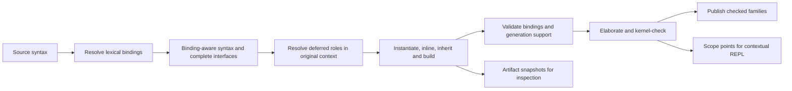

# Correct capture and bindings

Status: architecture and migration proposal, 2026-10-13. No CB package is
implemented. The baseline is `docs/frontend-generation-roadmap` at
`f0417ee0`; the motivating review is #219 at `d3d8f21e`. The
[open-PR comparison](../reports/capture-bindings-pr-comparison.md) records
what to adopt, replace and leave independent in the other current PRs.

Replace spelling-based capture repair with a frontend representation that
preserves binding identities through retention, substitution, inheritance,
generation and elaboration. Give lexical contexts an explicit representation
that also supports opening a REPL inside functions, nested induction cases
and proof blocks, with their actual local bindings and goals.

This replaces FG2's implementation approach and the binding-related part of
RC4 in #224, while retaining their semantic goals. It strengthens the
[syntax hygiene contract](syntax-hygiene.md); it does not require the later
PRs to merge unchanged before a better implementation can replace them.

## Outcomes and boundaries

Local variable spelling must not force users to rename helpers, patterns or
generated models to avoid compiler capture. Remove capture-only E801, E860,
E869 and E871 paths after their consumers migrate. Replace E866's expansion
hazard with explicit references to the previous dependency and the new
artifact. Preserve real duplicate declarations and ambiguous interfaces.
Preserve ordinary lexical shadowing as well: if a source parameter
`Monoid : Nat` hides the theory, `Monoid.one` must not silently reach the
global theory. That invalid source use (currently E862) is different from
a compiler transformation capturing an already resolved reference.

Binding correctness does not make every construction supported. Recursive
unfolding in field types, nonstructural self-recursion, unsupported transport,
universe lowering and unavailable dependencies remain distinct refusals.
In particular, preserving a recursive helper's identity does not make it an
admissible field-type dependency.

The parser/formatter can keep source names; core and kernel binders need no
representation change. The new boundary applies before frontend syntax is
retained or moved. Historical syntax stays behind a compatibility adapter,
not a second production binding semantics. This proposal adds no kernel
rule, axiom, deriving capability or universal-property proof.

## What must change

| Current mechanism | Demonstrated weakness | Replacement |
| --- | --- | --- |
| Globals use `reference`, open/local uses often remain `name` | A recursive call exposed by inlining can become a same-named global | Identity-bearing local/interface references; no destination spelling fallback |
| Dependency lookup combines interface and all eventual fields | A later helper replaces an earlier header parameter | Resolve in the ordered declaration scope; analyze occurrence IDs |
| Inlining combines reduction and selective refusal | Replacement children escape validation | Separate expansion from complete result/dependency validation |
| Pattern/statement binders are non-renamable | Capture prevention becomes a user-facing rename request | Explicit binder IDs and deferred pattern/goal-dependent roles |
| Offsets lack source ownership | An imported binder's range is interpreted in the caller | Source-qualified origins and separate expansion sites |
| REPL entries import the final module | Function locals, induction hypotheses and intermediate scopes are unavailable | A contextual session rooted in an elaboration scope point |

Retain the shared scope schema, structured members, global references,
publication groups and independent semantic clients. Extend their contracts
instead of adding another general visitor and another capture service.

## Shared representation

These are data contracts; implementation need not introduce a class or AST
kind for every row. Register any new kinds and opaque payload boundaries in
the common traversal schema.

| Record | Required information |
| --- | --- |
| Binding | Opaque ID, role, owner, public label and definition origin. Roles distinguish declarations, locals, universe/dimension binders, parameters, fields and helpers. |
| Reference occurrence | Binding ID, written spelling and occurrence origin. Role is obtained from the binding table, never inferred from spelling. |
| Declaration interface | Ordered parameter groups with explicit shared domains, result/body, open interface IDs, notation context and owned identities. |
| Lexical context | Immutable source-scope resolution and notation selections; explicit links to open binders; known missing lookups remain missing. |
| Deferred interpretation | Original syntax/operation, lexical-context ID, candidate binding slots and the type/goal information required to finish resolving it. |
| Origin | Source/module revision ID and offsets; expansion frames identify call, inheritance and generation sites without overwriting authored positions. |
| Artifact | Declaration/owner/group IDs, family/role, complete syntax, origins, dependencies and publication state. |
| Scope point | Revision, occurrence and before/after phase; lexical context, ordered checked local context, local values, refinements, dimensions/faces, evidence, recursion state and optional goal. |

IDs must distinguish same-spelled binders and survive serialization/replay
with an explicit correspondence. Do not derive them solely from labels,
offsets or JavaScript object identity. Allocate deterministically under a
compilation/module revision and declaration/expansion owner. Invalidating
changed revisions is sufficient; stable IDs across arbitrary edits are not
required. Compare independent runs up to binding correspondence.

The invariants are:

1. A resolved reference never asks the destination source environment what
   its spelling means. An unresolved source occurrence cannot become an
   unrelated destination declaration.
2. Every local reference has a dominating binder or belongs to an explicit
   open interface. A group's domain precedes all of that group's binders;
   subsequent groups and the result/body see them.
3. Cloning a declaration for a new instance freshens its bound IDs and all
   corresponding uses. External references remain shared. Merely revisiting
   immutable syntax does not allocate new identities.
4. Type-dependent choices retain their source context. They cannot silently
   count as fixed, dependency-free or supported before resolution.
5. Public labels, origins and availability are separate from identity.
   Named argument labels remain stable when internal IDs are freshened.
6. Knowing an artifact ID does not grant access to an unchecked reservation.
   Existing publication groups still control availability.

For example, a helper's reference to field `c` carries the field's ID. A
law parameter also spelled `c` has a different ID. Inserting the helper's
body under that parameter changes neither reference. Pretty-printing may
choose clearer labels, but semantic correctness does not depend on choosing
an unused spelling.

## Resolution and scoping

This is a phase contract, not an eager whole-program pass. Lexical resolution
fixes scope where text enters the compiler, in declaration order. Reserving
later identities does not make later declarations visible. A recursive
definition gets its permitted self-reference; unrelated forward references
remain unavailable. Preserve file-level `use` precedence, explicit selections
and B1's existing semantics.

Resolution interleaves with elaboration when types or proof goals decide
roles. Signatures may be checked in their ordered abstract telescope, in a
temporary context, without publishing assumptions or adding kernel axioms.
Reuse checked results when their context is unchanged; do not repeat whole
elaboration for each generator. Charge all attempts to existing budgets.

Distinguish two environments: lexical scope maps source occurrences to IDs;
elaboration maps IDs to current terms, types, dimensions and refinements.
Retained lexical contexts must not freeze mutable checker objects or native
handles that may be rolled back. An explicit open interface reconnects them
to the destination's checked context. A branch refinement changes the value
of a local without changing which lexical binding it is.

### Patterns, statement scopes and notation

`translator/patterns.mjs` resolves a bare pattern name as a nullary
constructor or a variable using its expected type. Giving every such token
an ordinary binder ID at parse time would change the language.

Use a deferred slot for each ambiguous position. An affected body occurrence
retains the candidate local slot and its enclosing lexical resolution,
including a missing lookup. When the type decides the role, a variable
introduces a binder ID; a constructor introduces no variable and the body
uses its saved enclosing resolution. Constructor selection itself follows
the matched type's constructor table. Preserve nested patterns, coordinates,
induction hypotheses and existing shadowing behavior.

Substitution under unresolved slots changes resolved references or records
an explicit substitution environment. An inserted argument keeps its own
references and is not retrospectively captured by a candidate binder.
Do not rewrite opaque clause text and then re-resolve it in the caller.

Statement targets get IDs as their binding effects become known. An
initializer sees preceding statements; later statements see its new IDs.
When a proof goal determines the effect of `intro`, `obtain`, `ext` or a
related statement, retain the remaining block with explicit slots and its
original lexical context until that effect is determined.

Notation records retain selected rule identities, original rule scope and
the separate contexts of operands. Selection may need a checked model;
retain that deferred receiver explicitly. A structural member keeps its
resolved receiver and public field label until the receiver's type selects
the projection ID. Neither is treated as a dotted global string.

Dependency analysis conservatively exposes dependencies/pending obligations
of deferred choices. A final support decision must resolve any choice that
can change admissibility in its original checked context. Do not classify
it as fixed or refuse every deferred pattern indiscriminately: the early
pilot must demonstrate both constructor and variable interpretations.

## Capture, substitution and inheritance

Retain complete parameter groups directly instead of reconstructing them
from equal-looking domain syntax. Generated evidence parameters are explicit
dependent groups. Derived operations share the declaration interface, adding
a body and call classification to their signature.

`instantiate(expression, interfaceId -> expression)` substitutes by ID.
It preserves the free identities of replacements; cloning freshens bound
IDs and their uses consistently. Changing a label does not change identity.
Named calls assign public labels to parameter IDs before substitution.
There is no comparison between free spellings and forbidden local names.

Inheritance uses an explicit parent-to-child field map. Child fields have
their own IDs and retain origin IDs. Diamond sharing and independent-parent
conflicts still obey the language rules. A field rename changes its public
label and correspondence, not arbitrary strings inside expressions.

Expansion of nonrecursive helpers is separate from validation of the full
expanded signature and its helper dependencies, with cycle detection.
Replacement subtrees cannot bypass validation because a generic visitor
stops at replacement nodes.

Classify references/calls as nonrecursive helpers, earlier checked recursive
values, or the current definition's structural self-calls. Preserve the
private recursion mechanism for the last case. Field types/laws keep E845
for unsupported recursive dependencies, including bare references and calls
hidden inside helpers. Ordinary derived values still call checked earlier
recursive operations. Point refusal at the written request, with the
helper definition as a related origin when useful.

## Frontend generation and checking

Dependency graphs consume occurrence IDs. Remove `DependencyAnalysis.byName`
as a semantic resolver; label indexes are for display only. Keep Hom/Iso and
equational support as distinct predicates and preserve their mapping plans.

A narrow builder constructs generated declarations using the same telescope
and reference representation. It allocates artifact and local IDs and
composes expressions directly. Remove the semantic round trip through
record conversions, source strings, reparsing and spliced name markers.
Formatting generated text for display remains valid; that text is never
read back to reconstruct its semantic bindings.

Adopt #220's universe inference from complete generated types, including
fixed domains and preservation fields. Binding analysis is not a replacement
universe calculator. Adopt #221's checked evidence and refinement/face/
generalization handling, carrying witness, type, model and dimensions
together. Evidence and generated references must respect failure/rollback.

A temporary adapter can lower IDs to private environment keys at elaboration
entry, as global references do today. It must install the exact mappings,
reject missing IDs and have no spelling fallback. Keep one such adapter;
retained records must never receive its private keys back as source names.

Preserve FG1's independent base, derived, Hom, Iso and initial/free publication
groups. Replacing capture does not justify a new all-or-nothing theory
transaction or exposing failed declarations through an inspection snapshot.

## Contextual REPL at arbitrary nesting depth

Opening a REPL inside a function or induction case is a required outcome,
not a possible future benefit. The depth limit is the language's ordinary
resource limits, not a fixed set of supported syntax depths.

The current `ReplSession` chains small modules importing the previous one.
Keep that module-level behavior. Add a contextual backend that elaborates
entries under a `ScopePoint` through the same resolver, elaborator and
checker as source code; importing the final module cannot supply this
context. Share command parsing and rendering, not a second checker.

### What the user can do

- Open a console from an expression, function body, proof statement or
  induction/match case, and see the enclosing scope path.
- List visible locals/lets with types and inspect their definition origins;
  show shadowed outer bindings separately without changing source lookup.
- Use `typeof`, `evaluate`, ordinary expression input and term inspection
  with the local notation, imported declarations, parameters and lets.
- Add checked scratch `let` bindings that persist only in that session.
  In a proof scope, inspect the active goal and try a proof fragment against
  a scratch copy of it. Successful experiments do not edit the source.
- Inside an induction case, access its predecessor/constructor arguments,
  induction hypotheses, refined dependent types and local evidence.

For example, after a branch-local `let next := succ(k)`, `typeof next`
reports `Nat` and `evaluate next` can report `succ(k)`. No concrete value of
`k` is invented. `/locals` and `/goal` are proposed console commands, not
new Cubist keywords. A function body has an expected result type where
known; it need not have a tactic goal. Evaluation of open terms may remain
symbolic. Closed-witness readout retains its existing closedness restriction.

The REPL observes an elaboration context, not a runtime stack frame from a
particular call. Supplying concrete arguments could later specialize a
session, but is not required to understand/check expressions under locals.

### Exact scope and lifetime

Index semantic entry points rather than every character: expression entry,
parameter-group domain/body, statement before/after, clause entry and proof
goal transitions. Keep parent links and source-qualified ranges so a click
selects the innermost relevant point. Never choose a nearby sibling or a
later scope merely because its source range is close. Let initializers
cannot see their own binding; later statements can. An arbitrary nesting
depth does not imply a valid context exists after a parse or scope error.

Scope points retain binding IDs, ordered types, let values, branch/face
refinements, interval dimensions, evidence, selected notation, recursive-call
permissions, available declaration identities and the optional goal. The
visibility environment is the one at that point, not the module's final
environment. The current definition's full checked body is not injected
retroactively into its own context; self-calls obey the same structural
rules as source elaboration, and induction hypotheses remain local.

Keep compact immutable context descriptions and source/expansion paths;
materialize execution state on demand. For the first implementation, use a
separate checker/kernel session: replay the pinned dependency/declaration
prefix and elaboration to the selected point, then execute queries in that
isolated context. This also handles a usable prefix inside a declaration
that later fails. Do not retain native pointers into a rolled-back parent
transaction or turn its unfinished declaration into a global assumption.
Preserve only contexts whose prefix was successfully elaborated; otherwise
show why the requested context is unavailable.

Replay is revision-pinned and must reach the same scope/expansion point;
it may use explicitly exported checked artifacts when their dependencies
and identity correspondence are validated. Start with source replay for a
clear ownership boundary, then optimize from measurements. Retaining a live
scope object or cloning an environment map alone is insufficient.

Each query checks under the local context, with its own ordinary budget.
Failed queries roll back scratch changes. Successful scratch definitions
cannot publish into the original program or another contextual session.
Results remain conditional on their local context; any later export must
abstract/check the full telescope, not advertise an open result as a closed
theorem. Full local declaration/import commands can be added through the
same explicit interface; the initial contextual surface requires expressions,
types, scratch lets and proof experiments.

Tie sessions to source/import revisions and scope IDs. A recheck marks them
stale; opening the new context requires replay and revalidation, never a
silent match by binder spelling. If the scope disappeared, report that.
Queue or cancel worker requests so old handles cannot outlive disposal.
Keep browser scope collection optional, and measure replay latency and
retained memory separately from normal checking.

## Origins, diagnostics and generated inspection

Keep authored origins immutable and attach expansion frames separately.
Binding diagnostics carry code, parameters, failure kind and source-qualified
primary/related spans. An imported failure can highlight the caller's
`extends` and link to the parent's binder; no offset is interpreted using
whichever `SourceUnit` catches it.

Adopt #222's public-label and lint guarantees and #225/#227's generated view.
Render retained artifacts with publication state, original source context
and binding-ID links. Remove `env.get(node.name)` from generated-reference
inspection. Display offsets differ from original origins; display failure
cannot alter checking. A generated expression can expose a contextual REPL
only if it has a replayable elaboration scope point, with its generated role
and original source visible. A refused/unelaborated artifact has no invented
checked context.

## Ordered implementation packages

Use #216 at `f0417ee0` or its reviewed successor as the replacement base;
it already includes FG0/FG1. Adopt later work selectively rather than merging
all intermediate representations first. These packages define implementation
boundaries, not repeated approval checkpoints.

| Package | Work and dependencies | Exit evidence and deletion |
| --- | --- | --- |
| CB0: baseline and witnesses | Pin adopted commits; adapt #224's useful fixture/observer improvements and #223's preservation machinery to current-stage expectations; add all review reproductions and contextual-session scenarios. | Record corpus, assumptions, artifacts and costs. Separate old TODOs from regressions; do not claim harness adoption fixes its TODOs. |
| CB1: identities, origins and scope points | Shared contracts and elaboration adapter; pilot complete ordinary telescopes, term/universe/dimension binders and persistent scope descriptions. | Cloning, grouped domains, serialization and source ownership work; missing IDs cannot fall back to names. Pilot replay into a nested function scope. |
| CB2: retained interfaces | On CB1, migrate headers, fields, derived telescopes, family domains, inheritance, helper expansion/validation and dependency analysis. | Fix both #219 semantic defects, bare recursive references and family helper resolution. Remove `byName` dependency resolution and migrated record/syntax/record conversions. |
| CB3: deferred scopes | On CB1/CB2, migrate patterns, proof statements, notation and structural selections; adopt #221's evidence/recursion behavior. | Constructor/variable alternatives and nested refinements preserve meaning. Former capture-only refusals get positive intended/negative captured clients; delete corresponding fixed-binder callbacks. |
| CB4: artifact builder | On CB2/CB3, migrate Hom first, then Iso, base projections and initial/free constructors/folds; adopt #220 inference and distinct support plans. | Remove each migrated textual/template path. Universe, preservation, fold computation and FG1 rollback controls pass. Generated patterns/references use IDs. |
| CB5: diagnostics and public views | Origins start in CB1; finish binding diagnostics, #222 label/lint behavior and #225/#227 generated inspection on CB3/CB4. | Imported spans, named clients and definition links survive. Remove ambient lookup from inspection and migrated message classifiers. |
| CB6: contextual REPL | Backend can develop after CB1; complete after CB3/CB5. Implement isolated replay/query sessions and source/generated-view entry points; reuse current console behavior where applicable. | Nested induction/function/let and proof-goal sessions work; sibling/late-name leaks, stale revisions, rollback and two-session interference are rejected. Queries leave the original program unchanged. |
| CB7: retirement and release | Audit every current-language producer/consumer after CB1–CB6; remove retained nominal-syntax fallbacks. | Remove capture-only E801/E860/E869/E871 implementations and E866 workaround; retire catalogue entries without reusing codes. Record the isolated historical adapter and complete release evidence. |

CB3's ambiguous pattern slot is the risk to prototype during CB1, before
spreading the representation to every generator. Scope-point replay is the
other early pilot: IDs alone do not make native context snapshots durable.
RC3 publication cleanup and broad test pragmas are independent, not blockers.
Small fixes to current PRs can still land while this replacement develops.

Each package names the code it removes. Transitional adapters are explicit
by phase/family and reject accidental mixed input. Production retention must
eventually use one reference model, not choose an old resolver on failure.

## Verification and completion

Each removed capture refusal needs a checked intended equation/computation
and a distinguishable incorrect one that fails. Mere kernel acceptance of
whatever type generation produced is not evidence of source preservation.

Required examples include all three #219 findings, imported/same-module/no
global recursive wrappers, bare recursive names, helpers in family domains,
grouped/dependent parameters, named arguments, legal shadowing, universe and
dimension binders, pattern constructors and variables, proof statements,
induction hypotheses, notation changes, parent/caller scope differences,
diamond inheritance and failed dependencies. Adding a same-spelled global
at the destination must not change an earlier reference or refusal.

Check free-ID preservation under substitution, coherent cloning, interface
closure and substitution composition up to binding correspondence. Extend
#223's bounded deterministic transformations and shrinking. Port mutations
to the new contracts: label-based rebinding, an omitted binder group, capture
under a deferred slot, skipped recursion validation, mixed source modules
or publication of a failed family. A patch that no longer applies is not a
killed mutant. Retire obsolete patches with replacement witnesses recorded.

For contextual REPLs verify exact before/after let visibility, nested branch
locals and hypotheses, refined goals and evidence, local notation, symbolic
evaluation, private recursion restrictions, successful and failed scratch
queries, independent sessions, imported/generated scope selection, source
edits and unavailable contexts after failure. Compare query results with an
independently written expression in the same source context. Include worker
queue/disposal and stale-context browser tests.

At release run native/frontend and corpus checks, inspector and static-site
browser tests, catalogue checks, mutation gates and publication fault
injection. Preserve fuel/deadline limits. Compare assumptions, inferred
interfaces and deterministic kernel work; additionally measure frontend
time, retained context/graph size, process memory and REPL replay latency,
with scope/artifact collection enabled and disabled. Existing arena reports
do not measure closure retention. Establish a justified budget from the
baseline before release instead of inventing an unmeasured percentage.

Completion requires the migrated consumers to preserve bindings, deletion
of capture-only workarounds with stronger semantic coverage, working
contextual REPLs and preservation of the adopted open-PR behaviors.
